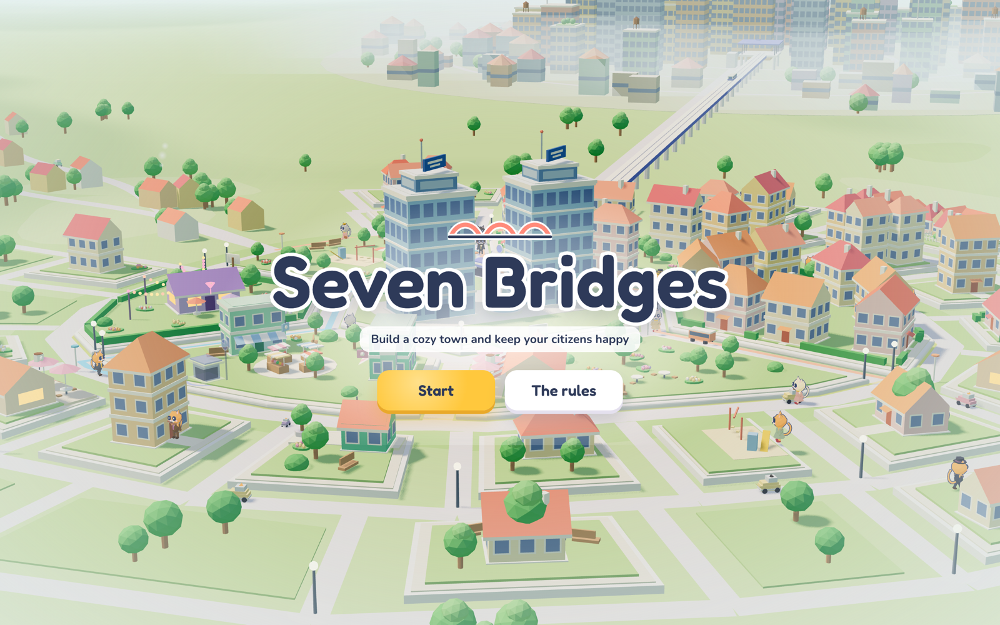

# Seven Bridges

**Build a cozy town and keep your citizens happy.**



Seven Bridges is a town-planning puzzle. Each level is a new random town. You
build on every block, connect the town, and keep your cats happy and busy. Your
rating is out of 100. A rating of 100 is the best plan for that town. Lean
proves which plan is best before the level starts.

## The rules

- Build on every block: homes, offices, shops, food, parks, bars.
- Neighbors matter: what is next door decides how happy and how productive each block is.
- Connect the town: roads, bridges, buses, a metro to downtown. Cars work too, but bring traffic and pollution.
- Stay within budget.
- Your rating is out of 100. 100 is the best possible town.

## Play

Play online: **https://vvennela.github.io/sevenbridges/**

The Lean backend runs in your browser as WebAssembly. No server is needed.

Press **Start** and pick Easy (5 blocks), Medium (7) or Hard (8). Pick a building
in the tray. Left-click a block to build or to add a floor. Right-click to take a
floor away. Press **Build** to get your rating. Press **View solution** to see the
best plan. The town then locks, and you go to the next town. The music player is
in the corner.

Run it locally:

```sh
cd web && npm install && npx vite            # http://localhost:5173
```

## The stack

| Part | What it does |
|---|---|
| **Lean 4.35** (`SevenBridges/`) | The rules, the cat simulation, the scoring, the solver, the level generator and every proof. It compiles to the backend program. |
| **Browser engine** (`Wasm.lean`, `wasm/`) | The same Lean backend, compiled to WebAssembly with Emscripten. It runs in a Web Worker. A second worker prepares the next town while you play. |
| **Bridge** (`server/bridge.mjs`, Node, optional) | Runs the native Lean program behind a WebSocket. Use it with `?server`. |
| **Game** (`web/`, TypeScript and three.js) | Draws the town and the cats. Sends your plan to Lean and shows what Lean returns. It does not compute any score. |

## Why Lean

A puzzle with a rating out of 100 needs a known best answer. A search program
can find a good answer, but a search program can have bugs. A bug can skip the
true best plan. Then a player can beat "100".

Lean is a programming language and a proof checker. The game rules and the solver
are Lean programs. Lean proves that the solver returns the best plan for the
rules, for every possible town. The game runs the same code that the proofs are
about. There is no second copy of the rules to keep in step.

This found a real bug. The first fast solver skipped some bus links when it
estimated the best possible score. The proof did not go through. The fix made the
estimate correct, and then the proof went through.

## What is verified

### 1. The best plan is the best plan

A plan is **valid** when it fits the town, stays within budget, and every bus
route and metro station that is on has enough riders
(`SevenBridges/Rules/Valid.lean`):

```lean
def ValidWith (c : Context) (s : Solution) : Prop :=
  FitsPuzzle c.puzzle s
  ∧ costOf c.puzzle s ≤ c.puzzle.budget
  ∧ TransitPays c s (simulate c s.transit s.look)
```

The **score** of a plan comes from one simulated day of the town's cats
(`SevenBridges/Rules/Score.lean`):

```lean
def scoreWith (c : Context) (s : Solution) : Int :=
  let d := simulate c s.transit s.look
  c.blocks.foldl (fun t i => t + blockValue c s.transit d s.look i) 0
    - shortagePenalty c s.transit d s.look
```

The solver uses branch and bound. It skips groups of plans that cannot beat the
best plan found so far. The main theorem says that the plan it returns is valid
and that no valid plan scores more (`SevenBridges/BranchProofs.lean`):

```lean
theorem solve_is_best (p : Puzzle) (s : Solution) (h : solve p = some s) :
    Valid p s ∧ ∀ t, Valid p t → score p t ≤ score p s
```

The rating follows from it. No valid plan rates more than 100. Only a best plan
rates exactly 100:

```lean
theorem rating_le_100 (p : Puzzle) (b : Solution) (hb : solve p = some b) (s : Solution) :
    rating p (score p b) s ≤ 100

theorem rating_eq_100_iff (p : Puzzle) (b : Solution) (hb : solve p = some b) (s : Solution)
    (hs : Valid p s) : rating p (score p b) s = 100 ↔ score p s = score p b
```

**Why this way:** the theorem is about every town, not only the towns we tested.
It is about the same `score` and `Valid` that the game uses. The screen and the
proof use one definition.

### 2. The cats' day

Each cat has a day: work, lunch, an evening out, home. Proven in
`SevenBridges/DayProofs.lean`:

```lean
-- Each cat's trips connect end to end and end at home.
theorem legs_return_home (cd : CatDay) :
    follow (.block cd.who.home) cd.legs = some (.block cd.who.home)

-- At every moment of the day, the cats in all places add up to all the cats.
theorem cats_conserved (c : Context) (T : Transit) (look : Nat → Building) (m : Moment) :
    ((places c).map (countAt (simulate c T look) m)).sum = (population c look).length

-- At night every cat is at home.
theorem night_at_home (c : Context) (T : Transit) (look : Nat → Building) :
    ∀ cd ∈ simulate c T look, cd.place .night = .block cd.who.home
```

`simulate_cats` and `population_nodup` prove that the simulation has each cat
exactly once.

### 3. The buses

Buses run a rush hour, stop by stop. Riders get off, then riders get on until the
bus is full. Proven in `SevenBridges/BusProofs.lean`:

```lean
-- No bus carries more than its capacity (15).
theorem routeRush_maxLoad_le (c : Context) (T : Transit) (d : List CatDay) (look : Nat → Building) (r dir : Nat) :
    ∀ x ∈ (routeRush c T d look r dir).maxLoads, x ≤ Numbers.busCapacity

-- Riders who got on + riders left at the stop = all riders who waited.
theorem routeRush_boarded_add_leftBehind (c : Context) (T : Transit) (d : List CatDay) (look : Nat → Building) (r dir : Nat) :
    (routeRush c T d look r dir).boarded + (routeRush c T d look r dir).leftBehind
      = ((rushParties c T d look r dir).map (·.people)).sum
```

`routeRush_all_off` proves that the buses are empty at the end.

### 4. The level generator

| Theorem | What it says |
|---|---|
| `generate_no_fixed` | A generated town has no blocks that are already built. |
| `generate_work_le` | The generator stops within its step budget. |
| `solveWithFuel_steps_le` | The solver stops within its step budget. |
| `empty_valid` | Every town has a valid plan (the empty town). |

### 5. How the proofs are checked

`lake check` builds the project in a sandbox and checks every proof again with
Lean's kernel. `--paranoid` checks every proof again with five more independent
checkers. Run it in Linux (`Checks/lakecheck.sh`):

```sh
docker run --rm --privileged -v "$PWD":/work -v sbelan:/root/.elan ubuntu:24.04 bash /work/Checks/lakecheck.sh
```

Result:

```text
Lean paranoid kernel accepts the solution
lean4lean kernel accepts the solution
nanoda kernel accepts the solution
con-leche: accepted 92924 declarations (--verified)
con-ron: accepted 92924 declarations (--verified)
Lean default kernel accepts the solution
Uses axioms: propext, Quot.sound, Classical.choice
```

The project has no `sorry`, no `native_decide` and no new axioms. The three
axioms above are Lean's standard axioms. `Checks/Audit.lean` lists the axioms of
each main theorem.

## Randomness

### Its role in the game

Randomness makes each level new. One seed makes the whole level:

- the shape of the town (round, oval, crescent, L-shape, peninsula, twin halves, grid),
- the river (none, straight, bend, fork) and the places where a bridge can go,
- the groups of residents (families, students, professionals, the elderly,
  artists, urbanites, rural newcomers) and their personalities,
- the cats: how each cat travels (walker, bus rider, driver), its day (work,
  study, retired), and if it eats out and goes out at night.

Different cats do different things. This makes the town feel alive, and it makes
each level a different puzzle. Lean proves the best plan for that exact
population.

### How it is verified

The browser picks each seed with its cryptographic random generator (32 bits).
The game does not repeat a seed that you played. Lean turns the seed into the
level with a 64-bit linear congruential generator. Proven in
`SevenBridges/RandomProofs.lean`:

```lean
-- Two different states never step to the same state.
theorem next_injective (r s : Rng) (hr : r.state < 2 ^ 64) (hs : s.state < 2 ^ 64)
    (h : r.next.2 = s.next.2) : r = s

-- So two different seeds give different random streams at every step.
theorem streams_differ (r s : Rng) (hr : r.state < 2 ^ 64) (hs : s.state < 2 ^ 64)
    (hne : r.state ≠ s.state) : ∀ n, (r.after n).state ≠ (s.after n).state

-- Full period, for any modulus 2^k (Hull–Dobell): the generator visits every
-- state once before it repeats.
theorem lcg_full_period (a c k x : Nat) (ha : a % 4 = 1) (hc : c % 2 = 1) (hx : x < 2 ^ k) :
    (∀ i j, i < j → j < 2 ^ k → lcgIter a c (2 ^ k) i x ≠ lcgIter a c (2 ^ k) j x) ∧
    (∀ y, y < 2 ^ k → ∃ n, n < 2 ^ k ∧ lcgIter a c (2 ^ k) n x = y) ∧
    lcgIter a c (2 ^ k) (2 ^ k) x = x

-- "A number below n": each result comes from 2^31/n or 2^31/n + 1 of the 2^31 raw values.
theorem below_fair (n k : Nat) (hn : 0 < n) (hk : k < n) :
    ((List.range (2 ^ 31)).filter (fun v => v % n == k)).length = 2 ^ 31 / n ∨
    ((List.range (2 ^ 31)).filter (fun v => v % n == k)).length = 2 ^ 31 / n + 1

-- Every cat's traits come only from the simulation seed, its home and its number.
theorem population_traits (p : Puzzle) (look : Nat → Building) (r : Resident)
    (hr : r ∈ population (prepare p) look) : r.traits = catTraits p r.home r.index
```

`rng_full_period` applies the full-period theorem to our constants (2^64
states). `choose_length`, `choose_mem` and `choose_nodup` prove that "choose k
items" returns k different items from the list.

**Why this way:** a proof cannot show that a seed is random. A proof can show
that the generator keeps the randomness of the seed: no collisions, no short
cycles, fair picks. The same seed always makes the same level, so anyone can
rebuild a level and check its best plan.

The output is also tested:

| Test | Result |
|---|---|
| `node tools/randomcheck.mjs 30`: 30 new towns from the backend | 30 different towns, 30 different simulations |
| `node web/scripts/randomness-e2e.mjs 12`: Start pressed 12 times in a browser | 12 different towns, 12 different simulations |
| Resident groups over 30 towns, chi-square test against equal chances | p ≈ 0.16: no group is favored |

## What the proofs depend on

| Item | How it is handled |
|---|---|
| The browser's random seed | Trusted |
| The Lean compiler, which turns the proven code into the backend | Trusted |
| Emscripten, which turns that code into WebAssembly | Trusted. `node wasm/compare.mjs` checks that the browser engine and the native program give the same replies: 26 of 26 matched byte for byte. |
| Starter-pack towns (`web/public/pack/`) | The native program made and solved them. The browser checks that each stored best plan is valid and has the recorded score before it uses the town. |
| The rules mean what we want | Reviewed by people. The rules are short Lean definitions with comments. |
| The drawing and the animation in the browser | Tested with screenshots and scripts |
| The set of levels | Random among the towns that pass the generator's quality checks. The generator drops levels where random play scores well or where the best plan has no homes. |

## Layout

| Path | What |
|---|---|
| `SevenBridges/Rules/` | The rules: map, buildings, culture, cats, the day, scoring, validity, rating. |
| `SevenBridges/Bound.lean`, `Branch.lean` | The fast solver. |
| `SevenBridges/BoundProofs.lean`, `BranchProofs.lean` | The proof that the fast solver returns the best plan. |
| `SevenBridges/DayProofs.lean`, `BusProofs.lean` | Proofs about the cats' day and the buses. |
| `SevenBridges/RandomProofs.lean` | Proofs about the random numbers. |
| `SevenBridges/Generator.lean` | The level generator. |
| `SevenBridges/Solver.lean`, `Proofs.lean` | A plain solver that tries every plan, with its proof. It cross-checks the fast solver. |
| `Main.lean` | The backend program (JSON in, JSON out). |
| `Checks/` | The axiom audit, the `lake check` script, timing and cross-check programs. |
| `tools/` | The map generator and test scripts. |
| `server/`, `web/` | The bridge and the game. |
| `DESIGN.md` | The full design. |
